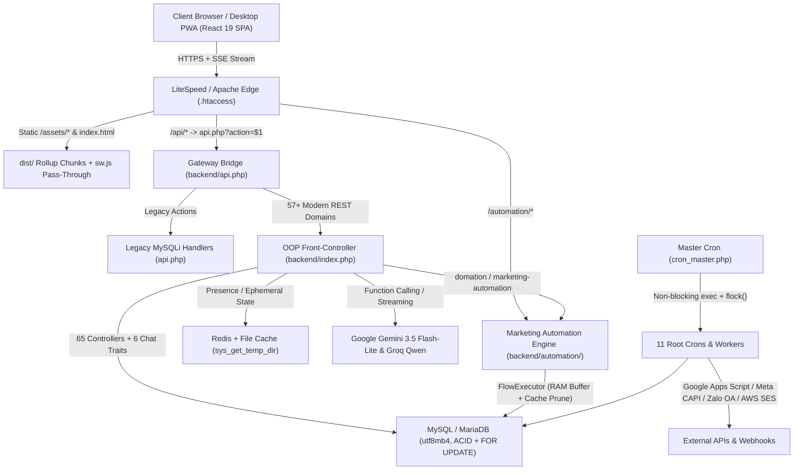
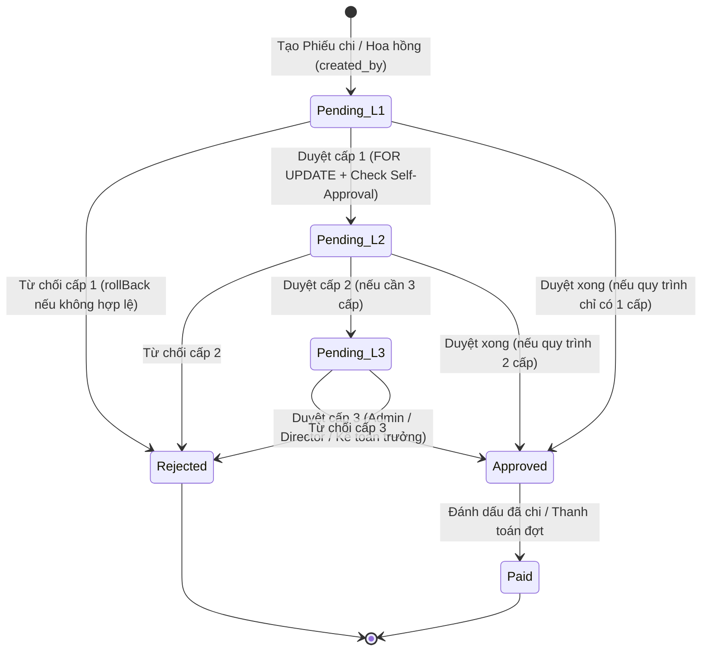
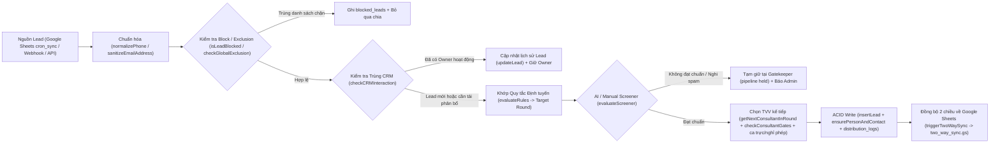
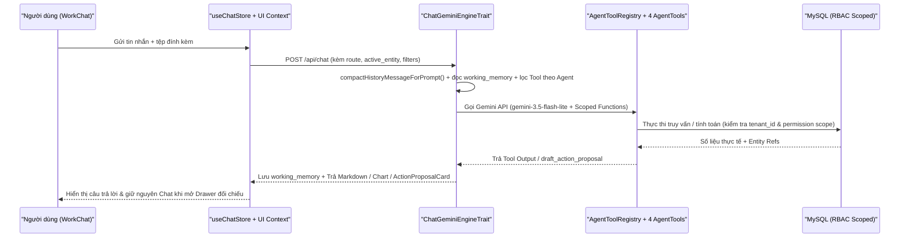
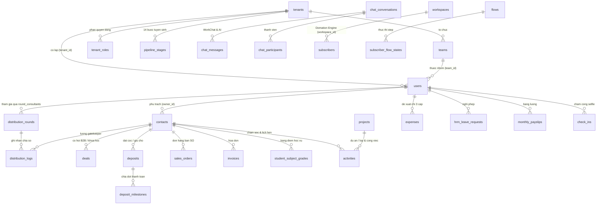

# Tài liệu Thiết kế Kiến trúc Hệ thống Chi tiết (Architecture Design — Handover Edition) — MYERP

> **Mục tiêu tài liệu**: Cung cấp bản thiết kế kỹ thuật chuyên sâu (*as-built architecture*) cho đội ngũ kỹ sư tiếp nhận bàn giao vận hành, bảo trì và mở rộng nền tảng **MYERP (Enterprise SaaS Operations Suite)**. Mọi thông số, tên class, tuyến API, bảng dữ liệu và bất biến đồng thời trong tài liệu được đối chiếu trực tiếp từ mã nguồn thực tế.

---

## Mục lục
1. [Bức tranh Tổng thể & Cấu trúc Workspace (C4 Container Topology)](#1-bức-tranh-tổng-thể--cấu-trúc-workspace-c4-container-topology)
2. [Kiến trúc Frontend (`src/` — React 19, Vite, State, Networking & 6-Tier Overlay)](#2-kiến-trúc-frontend-src--react-19-vite-state-networking--6-tier-overlay)
3. [Kiến trúc Backend (`backend/` — Dual-Router Bridge, Auth & REST Dispatch Matrix)](#3-kiến-trúc-backend-backend--dual-router-bridge-auth--rest-dispatch-matrix)
4. [Các State Machine Cốt lõi & Bất biến An toàn Đồng thời (Concurrency Invariants)](#4-các-state-machine-cốt-lõi--bất-biến-an-toàn-đồng-thời-concurrency-invariants)
5. [WorkChat Realtime & Hội đồng Multi-Agent AI (`SI IDEAS` + `Qwen Lab`)](#5-workchat-realtime--hội-đồng-multi-agent-ai-si-ideas--qwen-lab)
6. [Động cơ Marketing Automation (`backend/automation/`), Tracking & Meta CAPI](#6-động-cơ-marketing-automation-backendautomation-tracking--meta-capi)
7. [Kiến trúc Dữ liệu Đa Tenant (`~251` Bảng & Lược đồ ERD Liên phân hệ)](#7-kiến-trúc-dữ-liệu-đa-tenant-251-bảng--lược-đồ-erd-liên-phân-hệ)

---

## 1. Bức tranh Tổng thể & Cấu trúc Workspace (C4 Container Topology)

MYERP vận hành theo kiến trúc **Modular Monolith với Dual-Router Gateway**, tối ưu cho shared/cloud hosting LiteSpeed (`application/x-httpd-alt-php81`) kết hợp React 19 SPA/PWA:

| Thư mục / Thành phần | Số lượng / Công nghệ | Vai trò trong Kiến trúc | File neo chính |
| :--- | :--- | :--- | :--- |
| **Frontend SPA/PWA (`src/`)** | React `19.2.6`, TS `~6.0.2`, Vite `8.0.12`, Tailwind `4.3.0` (`81` pages, `554+` component files) | Giao diện quản trị hợp nhất (CRM, Học vụ, Tài chính, HRM, WorkChat, Marketing Studio) | [App.tsx](../src/App.tsx), [vite.config.ts](../vite.config.ts) |
| **PWA & HTTP Edge (`public/`)** | Pass-through Service Worker + Apache/LiteSpeed `.htaccess` | Cài đặt PWA không kẹt cache chunk cũ, ép `404` cho `/assets/*` thiếu, ép PHP `alt-php81` | [sw.js](../public/sw.js), [.htaccess](../public/.htaccess) |
| **Dual API Gateway (`backend/`)** | PHP 8.1+, PDO + MySQLi | Cổng `/api/*` đi qua `api.php` -> chuyển tiếp `57+` domain REST sang OOP `index.php` | [api.php](../backend/api.php), [index.php](../backend/index.php) |
| **OOP Domain Controllers** | `65` files trong `backend/controllers/` | Toàn bộ nghiệp vụ CRM, Tài chính, Đặt cọc, PO/SO, HRM, Học vụ, WorkChat, AI, Meta Ads | [AgentToolRegistry.php](../backend/controllers/AgentToolRegistry.php) |
| **Marketing Automation Engine** | `288` files trong `backend/automation/` (`18` worker scripts) | Thực thi Flow đa kênh (`FlowExecutor`), Email/Zalo/Meta, Survey, Voucher, Web Tracking | [FlowExecutor.php](../backend/automation/FlowExecutor.php) |
| **Database & Schema Evolution** | MySQL/MariaDB (`112` core tables + `119` net Domation + `20` migration/SaaS tables) | Lưu trữ chuẩn hóa `utf8mb4_unicode_ci`, cô lập theo `tenant_id` & `workspace_id`, Soft-Delete | [database_schema.md](../database_schema.md), [run_migrations.php](../backend/run_migrations.php) |
| **Background Scheduling** | `backend/cron_master.php` + `11` child tasks | Orchestrator 1 phút/lần (`flock`), Sync Google Sheets 2 chiều, Mailer, Reminder, Workers | [cron_master.php](../backend/cron_master.php), [cron_sync.php](../backend/cron_sync.php) |
| **Automated QA Harness (`tests/`)** | Node.js Test Runner (`tests/e2e/runner.js`) | `143` test case chia 4 tầng (Feature, Boundary, Cross-Feature, Chaos Defense) | [runner.js](../tests/e2e/runner.js) |

---

## 2. Kiến trúc Frontend (`src/` — React 19, Vite, State, Networking & 6-Tier Overlay)

### 2.1. Chiến lược Đóng gói Build, Version Stamping & Chống Kẹt Cache PWA
1. **`versionManifestPlugin()`** ([vite.config.ts](../vite.config.ts#L10-L43)): Ở mỗi lần `vite build`, hệ thống sinh timestamp `buildVersion` ghi vào `public/version.json`, [backend/version.json](../backend/version.json) và thay thế `SW_VERSION` trong [sw.js](../public/sw.js#L2).
2. **Manual Chunk Splitting** ([vite.config.ts](../vite.config.ts#L67-L92)): Tách thư viện nặng thành 8 chunk độc lập (`vendor-react`, `vendor-charts`, `vendor-icons`, `vendor-xlsx`, `vendor-pptx`, `vendor-framer`, `vendor-dnd`, `vendor`) giúp trình duyệt cache dài hạn mà không phải tải lại khi sửa UI nghiệp vụ.
3. **Pass-Through Service Worker** ([sw.js](../public/sw.js#L25-L50)): Để đáp ứng chuẩn cài đặt PWA của Chrome/Edge nhưng tuyệt đối không gây lỗi màn hình trắng khi đổi hash bundle mới, handler `fetch` không gọi `event.respondWith()`, nhường toàn bộ điều hướng HTML và `/assets/*` cho tầng mạng tự nhiên; đồng thời `.htaccess` ép `Cache-Control: no-store` cho `version.json`, `sw.js`, `manifest.json`, `index.html` và trả đúng `404` cho chunk cũ không còn tồn tại.
4. **Cơ chế Tự nhận diện Bản mới** ([AutoUpdateChecker.tsx](../src/components/AutoUpdateChecker.tsx), [axios.ts](../src/api/axios.ts#L333-L342)): Mọi response từ backend trả kèm header `X-App-Version`; Frontend bắt sự kiện `app-backend-version` và kiểm tra `/version.json` để nhắc/nạp lại phiên bản mới.
5. **Defensive Runtime Collection Unwrapping** ([safeArray.ts](../src/utils/safeArray.ts)): Cung cấp `ensureArray()` và `extractArray()` chuẩn hóa dữ liệu mảng trả về từ nhiều hình thái payload API (`res.data`, `res.data.items`, `{ list, rows, records }`, hoặc object lỗi `{}`) nhằm triệt tiêu lỗi `TypeError: ...map / .filter is not a function` trên toàn bộ pages & drawers.

### 2.2. Vòng đời Định tuyến (`App.tsx`) & Keep-Alive Tab Persistence
- **Pre-React Splash Guard** ([index.html](../index.html#L29-L40)): Đoạn script inline trước React kiểm tra token (`Ideas_token`/`access_token`) và public routes (`/login`, `/download`, `/public-schedule*`, `/docs*`) để ẩn `#ideas-splash-screen` ngay lập tức, tránh chớp màn hình chờ khi chưa đăng nhập.
- **Persistent `AppTabs` Pattern** ([App.tsx](../src/App.tsx#L378-L438)): Thay vì để React Router unmount toàn bộ DOM khi chuyển menu, `AppTabs` lưu danh sách `visitedPaths` đã mở. Tab ẩn được giữ sống bằng CSS (`display: 'none'`, `contain: 'strict'`, `contentVisibility: 'hidden'`). Mỗi tuyến được bọc riêng trong `ErrorBoundary` và `Suspense` với `RouteTabSkeleton`, hỗ trợ reset riêng lẻ qua sự kiện `window.dispatchEvent(new CustomEvent('refresh-page', { detail: { path } }))`.
- **Ma trận Tuyến công khai vs Nội bộ & Phân quyền** ([App.tsx](../src/App.tsx#L164-L376)):

| Tuyến Route | Điều kiện Quyền / Role Guard | Component Đích |
| :--- | :--- | :--- |
| `/login`, `/report-data`, `/demo`, `/download`, `/splash-preview` | Public (không qua `ProtectedRoute`) | `Login`, `ReportData`, `DemoEntry`, `DownloadPage`, `SplashPreviewPage` |
| `/public-schedule/*`, `/public-booking/1on1/*`, `/s/:slug`, `/claim/:id`, `/docs*`, `/api-docs*` | Public Portal & Documentation | `PublicSchedulePage`, `PublicBooking1on1Page`, `PublicSurveyPage`, `PublicVoucherClaimPage`, `DocumentationPage`, `ApiV1DocumentationPage` |
| `/` | `isAcademic` -> Workspace; `sale`/`sales` -> SalePortal Dashboard; Khác -> Executive Dashboard | `SalePortal` / `Dashboard` |
| `/workspace`, `/account`, `/calendar`, `/personal-calendar` | Authenticated (Accountant trên `/calendar` trỏ sang `DataList`) | `SalePortal` (`embedMode`) / `DataList` |
| `/contacts`, `/students`, `/data`, `/companies`, `/deals`, `/quotes`, `/activities`, `/gatekeeper`, `/tickets` | `ProtectedRoute` + Scope RBAC phía API | `ContactsPage`, `DataList`, `CompaniesPage`, `DealsPage`, `QuotesPage`, `ActivitiesPage`, `Gatekeeper`, `Tickets` |
| `/rounds`, `/rules`, `/integrations`, `/settings` | `admin`, `superadmin`, `director`, `marketing`, (`manager` cho `/settings`) hoặc dynamic `settings:read` | `Rounds`, `RuleSettings`, `Integrations`, `Settings` |
| `/accounts` | `admin`, `superadmin`, `director`, `hr` hoặc `users:read` | `Accounts` |
| `/deposits`, `/cash-flow`, `/accounting-az`, `/financial-dashboard`, `/hrm`, `/my-payslips` | `deposits:read`, `isExecutive`/`isAccountant`/`isHR` hoặc dynamic `finance:read`/`hrm:read` | `DepositsPage`, `HrmAccountingAzWorkspace`, `FinancialDashboard`, `HRM`, `MyPayslips` |
| `/marketing`, `/marketing/*`, `/capi` (`13` module Marketing) | Strict `canAccessMarketingRoute(user, route)` (chặn hoàn toàn `sale` ở cả UI & API) | Các page trong `src/pages/marketing/*` & `CapiPage` (bọc trong `.mkt-scope`) |

### 2.3. Tầng State Management (Zustand + React Contexts)
- **`useAuthStore`** ([authStore.ts](../src/store/authStore.ts#L32-L100)): Persist vào `localStorage` dưới key `minth-auth`. Chuẩn hóa role (`sales` -> `sale`, `super_admin` -> `superadmin`), và giải phân quyền `getModulePermissionScope(user, module, action)` theo 4 nấc `all | team | own | none`.
- **`useUIStore`** ([uiStore.ts](../src/store/uiStore.ts#L66-L100)): Khử trùng lặp thông báo Toast trong cửa sổ `1200ms`, điều phối `ConfirmModal`, `QRCodeCallModal`, `POSModal` và 5 Global Drawers (`customerDrawer`, `taskDrawer`, `expenseDrawer`, `approvalDrawer`, `depositDrawer`).
- **`useChatStore`** ([chatStore.ts](../src/store/chatStore.ts#L1-L100)): Kho trạng thái trung tâm của WorkChat & `SI IDEAS`, cung cấp `getClientCurrentContext()` tự động gửi ngữ cảnh trang (`pathname`, `active_entity`, `__MYERP_CONTACTS_ACTIVE_FILTERS__`), đồng bộ đa tab (`chatBroadcast.ts`), cache IndexedDB (`chatIndexedDB.ts`) và prewarm sticker/avatar (`chatAssetPrewarmer.ts`).
- **`TenantConfigContext`** ([TenantConfigContext.tsx](../src/contexts/TenantConfigContext.tsx#L1-L70)): Nạp runtime metadata đa tenant (`TenantOrganization`, `TenantRoleDef[]`, `TenantTeamDef[]`, `TenantStudentTabDef[]`, `TenantAcademicProgramDef[]`) giúp thay đổi cấu trúc học vụ, vai trò và email template không cần sửa code.

### 2.4. Tầng Giao tiếp HTTP, Caching & Chống Tắc Mạng
- **Host Firewall & URL Normalization** ([axios.ts](../src/api/axios.ts#L266-L326)):
  - URL base tự động chọn `/backend` (Vite proxy) ở `localhost` và `${window.location.origin}/backend` trên domain Production/Staging ([env.ts](../src/config/env.ts#L1-L11)).
  - Toàn bộ `PUT`, `PATCH`, `DELETE` tới API ERP được chuyển đổi sang `POST` kèm `_method=<METHOD>` và ánh xạ URL về `api.php?action=<endpoint>` (giữ nguyên `/automation/*` đi trực tiếp).
- **2 Tầng Cache & In-Flight Deduplication**:
  - **ERP Core (`axios.ts`)**: `30` endpoint danh mục (`CACHEABLE_ENDPOINTS`) dùng cache `60s` (`MAX_CACHE_ENTRIES = 250` theo LRU) kết hợp gộp các GET trùng nhau đang chạy (`pendingRequests`); tự động xóa sạch cache khi có bất kỳ request `POST`/`PUT`/`PATCH`/`DELETE` nào.
  - **Marketing Suite (`domationApi.ts`)** ([domationApi.ts](../src/services/domationApi.ts#L40-L70)): Burst TTL `15s` (triệt tiêu StrictMode double-mount), Reference TTL `60s`, Stale-While-Revalidate tối đa `10` phút (`MAX_ENTRIES = 300`), và bus sự kiện `domation:invalidate`.
- **Single-Flight `401` Refresh & Auto-Retry** ([axios.ts](../src/api/axios.ts#L328-L423)): Mutex `refreshInFlightPromise` đảm bảo nhiều API hết hạn cùng lúc chỉ kích hoạt `1` request `auth/refresh`; request `GET`/`HEAD` lỗi mạng hoặc gateway `502–504` tự thử lại tối đa `2` lần (`600ms`, `1200ms`).

### 2.5. Hệ thống Overlay Z-Index 6 Tầng, Phím tắt LIFO & App Iconography
- **Chuẩn hóa Z-Index & Đóng LIFO** ([overlayStack.ts](../src/utils/overlayStack.ts#L33-L120)):
  - **Tier 2**: `work-chat-modal` (`10010`), `mobile-sidebar-drawer` (`11000`).
  - **Tier 3**: Global Drawer Wrappers (`2147483622`), Primary Slide-over Drawers (`2147483625`).
  - **Tier 4**: Secondary Nested Drawers (`2147483635`: `workspace-task-drawer`, `ticket-drawer`, `deposit-detail-drawer`, `expense-quick-view-drawer`, `approval-detail-drawer`).
  - **Tier 5**: Submodals trong Profile (`2147483641`), Modals chuẩn (`2147483644`), Topmost Confirm/Lightbox/Signature (`2147483646`), và Toast Portal (`2147483647`).
- **Global Keyboard & Swipe Ergonomics** ([App.tsx](../src/App.tsx#L447-L628), [useNativeAppBackGuard.ts](../src/hooks/useNativeAppBackGuard.ts)): Chặn xung đột bộ gõ Telex/VNI (`e.isComposing || e.keyCode === 229`), `ESC` chỉ đóng lớp trên cùng của `overlayStack`, `Ctrl+S` lưu form, `J`/`K`/`Enter` điều hướng bảng, `Alt + [phím]` chuyển nhanh phân hệ, và giữ tương phản `/workspace` bằng kính tối khói (`rgba(15, 23, 42, 0.72)`) + lớp phủ top gradient trên ảnh nền sáng ([SalePortal.tsx](../src/pages/SalePortal.tsx)).
- **Hệ thống App Icons Đa sắc** ([AppIcons.tsx](../src/components/common/AppIcons.tsx), [AppLauncherModal.tsx](../src/components/ui/AppLauncherModal.tsx)): Toàn bộ icon phân hệ sử dụng gradient `<defs>` với ID duy nhất (zero SVG gradient ID collisions) và phân tách màu theo ngữ cảnh nghiệp vụ.

---

## 3. Kiến trúc Backend (`backend/` — Dual-Router Bridge, Auth & REST Dispatch Matrix)

### 3.1. Vòng đời Xử lý Request & Bảo vệ An toàn Hệ thống
1. **Gateway Bridge** ([api.php](../backend/api.php#L67-L166)):
   - Tự phục hồi action truyền nhầm nhiều `?` thay vì `&`, loại bỏ tiền tố `/v1/` hoặc `/api/`, kiểm tra `$baseAction` thuộc danh sách `57+` domain REST -> nạp `backend/index.php` và thoát sớm; các action cũ tiếp tục chạy trong `api.php`.
2. **Hạ tầng Tầng Đầu (`index.php`)** ([index.php](../backend/index.php#L1-L252)):
   - **Tắt Zlib thông minh**: Tắt nén gzip trên các đường dẫn SSE/Stream (`chat/stream`, `chat/messages`, `get_sse_updates`).
   - **Multi-Tenant CORS Cache (`300s`)**: Truy vấn domain từ `system_settings` + `tenants`, cache vào `sys_get_temp_dir()/myerp_tenant_origins_v2.json`, đồng thời cho phép `localhost`, `*.vercel.app`, `*.zalo.me`.
   - **`getBody()` Sanitization**: Đệ quy ép các chuỗi rỗng / `'0000-00-00'` / `'1970-01-01'` ở nhóm trường ngày thành `null`, và các chuỗi rỗng ở trường tiền tệ (`amount`, `price`, `base_salary`...) thành `0` trước khi chạm PDO.
   - **`respond()` Auto-Rollback & ETag**: Khi `$code >= 400`, tự kiểm tra `$db->inTransaction()` và `rollBack()` ngay lập tức để không làm treo lock MySQL; với `GET 200`, tính `ETag` MD5 hỗ trợ `304 Not Modified`.

### 3.2. Zero-Trust Auth, Dynamic RBAC & Multi-Tenancy
- **Env-Only Config & Fail-Closed Boot** ([config.php](../backend/config.php), [Config.php](../backend/config/Config.php)): Đọc bắt buộc `DB_USER`, `DB_PASS`, `DB_NAME`, `JWT_SECRET`, `DIAG_TOKEN` từ `backend/.env` / biến môi trường (fail-closed `RuntimeException` nếu thiếu cấu hình bảo mật).
- **HS256 JWT + Active DB Check (60s File Cache)** ([index.php](../backend/index.php#L253-L321), [JWT.php](../backend/config/JWT.php)): `requireAuth()` xác thực chữ ký `hash_hmac('sha256')`, nạp thông tin user còn hiệu lực (`is_active = 1 AND deleted_at IS NULL`) từ MySQL hoặc file cache `myerp_auth_u_{uid}_{tid}.json` (TTL `60s`), chuẩn hóa `sale` -> `sales`.
- **`TenantConfigService`** ([TenantConfigService.php](../backend/config/TenantConfigService.php#L3-L305)):
  - Quản trị `33` module hệ thống (`TenantConfigService::MODULES`), cấp phát/cập nhật tự động `6` bảng cấu hình SaaS: `tenant_roles`, `tenant_approval_workflows`, `tenant_notification_rules`, `tenant_student_tabs`, `tenant_academic_programs`, `tenant_email_templates`, và khóa chính kép `(tenant_id, setting_key)` trên `system_settings`.
  - Hỗ trợ `doesUserSatisfyRoles()`, `canUserSelfApprove()`, `canUserApproveWorkflowLevel()` và `invalidateCache($tenantId)` đồng bộ xóa toàn bộ ephemeral cache file.

### 3.3. Bảng Định tuyến Toàn bộ REST Controllers ([backend/index.php](../backend/index.php))

| Nhóm Nghiệp vụ | Resource / Route Prefix | OOP Controller | Quyền & Cơ chế Bảo vệ chính |
| :--- | :--- | :--- | :--- |
| **Xác thực & Tài khoản** | `auth/*`, `users/*`, `presence/*`, `tenant-config/*` | `AuthController`, `UserController`, `PresenceController`, `TenantConfigController` | `login`/`refresh`/`forgot-password`/`verify-2fa` public; `users` store/delete yêu cầu `admin`/`super_admin`/`director`; 2FA TOTP ([TOTP.php](../backend/utils/TOTP.php)). |
| **CRM & Khách hàng** | `contacts/*`, `companies/*`, `deals/*`, `quotes/*`, `pipeline-stages/*`, `tags/*`, `custom-fields/*`, `contact_presence_*` | `ContactController`, `CompanyController`, `DealController`, `QuoteController`, `TagController`, `CustomFieldController` | Row-level IDOR check theo `owner_id`, `collaborator_ids`, `quyen_truy_cap`; Xóa mềm `bulk-delete`; đồng bộ silent match Domation. |
| **Chia số & Gatekeeper** | `lead-distribution/*`, `consultant-shifts/*`, `connectors/*` | `LeadDistributionController`, `ConsultantShiftController`, `ConnectorController` | Kiểm quyền `contacts:approve` với `assignLead`, khóa dòng `FOR UPDATE` trên `contacts` khi bàn giao/phân bổ; ghi `distribution_logs`. |
| **Học vụ (Academic)** | `academic/*`, `academic-affairs/*` | `AcademicAffairsController` | `public-1on1` công khai theo `booking_code` (khóa `FOR UPDATE` slot 1:1); bảng điểm lớp/cá nhân, bảo lưu + OCR (`StudentDocOcrService`), mời giảng. |
| **Tài chính & Đặt cọc** | `deposits/*`, `cooperation-slips/*`, `invoices/*`, `expenses/*`, `finance/*` | `DepositController`, `CooperationController`, `FinanceController` | Transaction + `FOR UPDATE`, Anti-Self-Approval theo cấp độ duyệt, đồng bộ công nợ & KPI thực thu/thực chi. |
| **Đơn hàng, POS & Kho** | `sales-orders/*`, `purchase-orders/*`, `pos/*`, `inventory/*`, `products/*`, `suppliers/*` | `SalesOrderController`, `PurchaseOrderController`, `POSController`, `InventoryController`, `ProductController`, `SupplierController` | Trừ kho an toàn, duyệt PO/SO theo workflow, phiên POS (`sessions`, `orders`), lưu `inventory_logs`. |
| **HRM & Lương** | `hrm/*`, `attendance/*`, `check-ins/*`, `check_ins/*`, `assets/*`, `teams/*` | `HRMController`, `CheckInController`, `AssetController`, `TeamController` | Khóa bảng lương, duyệt nghỉ phép/tạm ứng/bổ sung công hàng loạt, cấp phát/thu hồi tài sản (`hrm_assets`), phân hệ Kế toán A–Z (`accounting-az/*`, XML HTKK). |
| **Công việc, Dự án & Social** | `tasks/*`, `project-tasks/*`, `activities/*`, `task-groups/*`, `projects/*`, `classes/*`, `posts/*`, `comments/*`, `workflow-task-templates/*` | `ProjectController`, `ActivityController`, `TaskGroupController`, `PostController`, `WorkflowTaskTemplateController` | Kanban, Gantt, Pomodoro Focus Log, Whiteboard + Snapshot version lock (`FOR UPDATE`), Bảng tin & Vinh danh nội bộ. |
| **Tệp, Helpdesk & Thông báo** | `cloud-files/*`, `file-categories/*`, `upload`, `download-file`, `tickets/*`, `notifications/*` | `CloudFileController`, `FileCategoryController`, `UploadController`, `TicketController`, `NotificationController` | Chống Path Traversal (`deleteServerFile`), OCR CCCD/Hợp đồng, SLA ticket & IDOR `checkTicketAccess`, thông báo tenant-scoped. |
| **BI, Search, Export & Cron** | `dashboard/*`, `badges`, `reports/*`, `export`, `import/*`, `search/*`, `crons/*` | `DashboardController`, `ReportController`, `ExportController`, `ImportController`, `SearchController`, `CronController` | Bảo toàn **4-Way Data Parity** (`UI <-> AI <-> Segment <-> Export`). |
| **WorkChat & AI Multi-Agent** | `chat/*`, `ai/*`, `qwen-agent/*`, `customer-journey-summary` | `ChatController`, `AIController`, `QwenAgentController` | SSE Realtime (`chat/stream`), Delta Sync (`chat/sync`), Gemini Tool Swarm (`chat`), Groq Qwen Lab tách rời (`qwen-agent`). |
| **Marketing, Ads & Domation** | `marketing/*`, `campaigns/*`, `marketing-campaigns/*`, `capi/*`, `meta-ads/*`, `omnichannel/*`, `domation/*`, `marketing-automation/*` | `CampaignController`, `MetaAdsController`, `CapiController`, `OmnichannelController`, `DomationOmnichannelController`, Router `automation/` | CAPI Dual-Pixel, Meta Full-Funnel Attribution, Zalo/ZNS Broadcast, cầu nối tới `backend/automation/*.php`. |

---

## 4. Các State Machine Cốt lõi & Bất biến An toàn Đồng thời (Concurrency Invariants)

### 4.1. Luồng Phê duyệt Tài chính, Đặt cọc & Chi phí Đa cấp
Hệ thống bảo vệ toàn vẹn sổ cái tài chính bằng **3 nguyên tắc cứng**:
1. **Row-Level Locking (`SELECT ... FOR UPDATE`)**: Bắt buộc trong mọi thao tác biến đổi trạng thái tiền tệ ([DepositController.php](../backend/controllers/DepositController.php#L1089-L1339), [FinanceController.php](../backend/controllers/FinanceController.php#L451-L1800)) — với helper tương thích SQLite cho môi trường test unit/E2E (`$isSqlite ? '' : ' FOR UPDATE'`).
2. **Chống Tự Phê duyệt (Anti-Self-Approval)**: Kiểm tra chéo `created_by === auth['user_id']` qua `TenantConfigService::canUserApproveWorkflowLevel()` và `canUserSelfApprove()` — trả `HTTP 403` ngay khi người tạo tự duyệt phiếu chi, đặt cọc hoặc hoàn cọc (trừ vai trò điều hành được cấu hình tường minh).
3. **Ma trận Duyệt Chi 3 Cấp (`expenses`)**: Dựa trên các cột `status_level_1`, `status_level_2`, `status_level_3` trong [FinanceController.php](../backend/controllers/FinanceController.php#L1812-L1850) và tự phân loại luồng `commission` vs `expense`.

### 4.2. Động cơ Chia Số Thông Minh (Gatekeeper, Fair-Share & Google Sheets 2 Chiều)
Luồng tiếp nhận và phân bổ Lead tại [webhook_logic.php](../backend/webhook_logic.php) kết hợp [LeadDistributionController.php](../backend/controllers/LeadDistributionController.php) vận hành theo đường ống tuần tự:

### 4.3. Đồng bộ 4 Bề Mặt Dữ liệu (`4-Way Data Parity`) & CRM 14 Stages
Từ Migration `237` ([237_ideas_14_pipeline_stages.sql](../backend/migrations/237_ideas_14_pipeline_stages.sql)), toàn bộ vòng đời tuyển sinh của `contacts` & `deals` tuân theo chuẩn `14` giai đoạn kèm phân tách trạng thái `lead_status` (`active | nurture | lost`) và `lead_temperature`. Hệ thống đảm bảo cùng một tập điều kiện lọc (`program`, `project_id`, `stage_id`, `owner_id`, `from_date`, `to_date`) trả về kết quả đồng nhất 100% qua 4 bề mặt:
1. Web App Views (`/contacts`, `/students`, Decks BI)
2. AI Agent Tools ([AgentToolRegistry.php](../backend/controllers/AgentToolRegistry.php))
3. Marketing Dynamic Segments & Static Lists (`segment_helper.php`, `createOrPopulateStaticList`)
4. File xuất Excel/CSV ([ExportController.php](../backend/controllers/ExportController.php))

---

## 5. WorkChat Realtime & Hội đồng Multi-Agent AI (`SI IDEAS` + `Qwen Lab`)

### 5.1. Kiến trúc Trait-Based `ChatController` & Kênh SSE Tiết kiệm Tài nguyên
[ChatController.php](../backend/controllers/ChatController.php) tách logic ra **6 PHP Traits** độc lập:
- `ChatCoreTrait`: CRUD tin nhắn, phản hồi cảm xúc, ghim, forward, Vault file.
- `ChatManagementTrait`: Tạo hội thoại nhóm/1-1, phân quyền thành viên, dọn lịch sử.
- `ChatStreamAndAiEntryTrait`: Endpoint `chat/stream` sử dụng **Non-blocking Global Index Check** ([ChatStreamAndAiEntryTrait.php](../backend/controllers/ChatStreamAndAiEntryTrait.php#L54-L80)) — truy vấn `SELECT MAX(id) FROM chat_messages` (`< 5ms`); chỉ khi có ID mới hơn `last_message_id` mới thực thi JOIN 4 bảng và phát event SSE `new_messages`, giúp không làm nghẽn PHP-FPM workers; đồng thời cập nhật `chat:presence:{tid}:{uid}` lên Redis (TTL `60s`).
- `ChatAgentContextTrait`: Gom ngữ cảnh thực thể đang mở từ Frontend (`getClientCurrentContext()`), dữ liệu RAG tri thức đào tạo và quyền người gọi.
- `ChatGeminiEngineTrait`: Động cơ AI chính (`gemini-3.5-flash-lite` mặc định hoặc cấu hình tenant).
- `ChatGroqAndMemoryTrait`: Fallback Groq và quản lý bộ nhớ ngữ cảnh hội thoại `<working_memory>`.

### 5.2. Cơ chế Hub & Spoke Tool Scoping của 11 AI Agents
Danh sách 11 Agent được đồng bộ 1-1 giữa Frontend ([aiAgents.ts](../src/constants/aiAgents.ts#L26-L352)) và Backend (`$agentToolMap` trong [ChatGeminiEngineTrait.php](../backend/controllers/ChatGeminiEngineTrait.php#L71-L88)):

| Agent ID | Tên & Chuyên môn | Kho Công cụ Đặc trưng | Cơ chế An toàn & Bảo vệ |
| :--- | :--- | :--- | :--- |
| `master` | **SI IDEAS** (Chỉ huy & Tri thức) | `query_cross_domain_executive_synthesis`, `search_ideas_knowledge`, `get_program_details`, `trace_approval_blocker` | Mọi ghi DB bắt buộc qua Thẻ Hành Động (`ActionProposalCard`) |
| `tasks` | **Agent Task** (WBS & Deadline) | `query_tasks_and_projects_multitier`, `smart_manage_tasks_and_subtasks`, `complete_task_checklist_item` | Chỉ thao tác việc thuộc phạm vi tạo/giao/giám sát |
| `finance` | **Agent Thu Chi** (PO / SO / Cọc) | `query_finance_multitier_analytics`, `query_deposits_and_revenue_multitier`, `smart_manage_po_so_and_approvals` | Nhắc duyệt 2 cấp với khoản chi `>= 5.000.000đ`, chống ghi đè |
| `sales` | **Agent Sales** (CRM 360°) | `query_crm_leads_multitier`, `get_lead_digital_footprint_360`, `get_sales_leaderboard`, `reassign_lead_owner` | Chặn IDOR & giới hạn scope Sale theo `owner_id`/`collaborator_ids` |
| `hrm` | **Agent Nhân Sự** (Chấm công & Lương) | `query_hrm_workforce_and_payroll_multitier`, `manage_my_hr_profile_and_requests`, `trace_approval_blocker` | Cô lập `get_my_payslip` theo chính chủ; ẩn lý do nghỉ việc với non-HR/Admin |
| `academic` | **Agent Đào Tạo** (Swiss UMEF / ISTEC) | `get_academic_students_filter`, `get_academic_schedule_and_intakes`, `get_program_details` | Tuân thủ khung tín chỉ ECTS & quy chế học phí ban hành |
| `records_legal` | **Agent Hồ Sơ & Pháp Lý** | `check_student_admission_records`, `attach_files_to_contact`, `get_contact_360_profile` | Kiểm tra đủ giấy tờ pháp lý/dịch thuật công chứng trước xét tuyển |
| `assets_inventory` | **Agent Tài Sản & Kho** | `query_inventory_and_assets_multitier`, `get_inventory_health_check`, `get_inventory_and_asset_status` | Giao nhận tài sản/ấn phẩm bắt buộc tạo phiếu đề xuất duyệt |
| `marketing_campaigns` | **Agent Marketing** (Domation & Ads) | `query_omnichannel_journey_and_automation_analytics`, `smart_manage_automation_flows_and_campaigns` | Đồng bộ "3 KHÔNG" (Match-Only); giới hạn xem Ad Spend theo quyền MKT |
| `executive_bi` | **Agent Trợ Lý Giám Đốc** (BI/P&L) | Toàn bộ `*_multitier` tools + `get_executive_morning_brief`, `get_executive_financial_pulse` | Chỉ mở cho `director`, `superadmin`, `accountant` |
| `system_it` | **Agent Kỹ Thuật & Vận Hành** | `query_tickets_and_sla_multitier`, `get_system_health_status`, `get_ticket_status_and_sla_breaches` | Không làm lộ secret key/DB password trong log & phản hồi |

*(Bên cạnh nhánh Gemini chính, phân hệ [QwenAgentController.php](../backend/controllers/QwenAgentController.php) vận hành tuyến `/api/qwen-agent/*` tách biệt hoàn toàn trên Groq Cloud phục vụ thử nghiệm & đối chiếu mô hình.)*

---

## 6. Động cơ Marketing Automation (`backend/automation/`), Tracking & Meta CAPI

### 6.1. `FlowExecutor` & 18 Tiến trình Worker Độc lập
- **`FlowExecutor.php`** ([FlowExecutor.php](../backend/automation/FlowExecutor.php#L10-L100)) điều phối từng bước kịch bản (`wait`, `email`, `zalo`, `zns`, `meta`, `condition`, `tag`, `split`) cho subscriber trên bảng `subscriber_flow_states` & `flow_enrollments`:
  - **RAM Stats Buffering (`bufferStatsUpdate` / `flushStatsBuffer`)**: Dồn hàng trăm bộ đếm (`stat_total_sent`, `stats_opened`, `stats_clicked`...) trong bộ nhớ trước khi ghi batch một lần vào DB, dùng whitelist bảng/cột tĩnh chặn SQL Injection.
  - **Bounded Static Caches (`pruneCache`)**: Tự giới hạn `$tagCache` và `$profileCache` ở mức `200` bản ghi để worker chạy dài hạn (`10k+` subscribers) không bị tràn RAM.
- **`18` Worker Chuyên biệt**: Tách biệt tải nặng thành các tiến trình độc lập theo hàng đợi (`worker_flow`, `worker_priority`, `worker_campaign`, `worker_enroll`, `worker_trigger`, `worker_queue`, `worker_segment_counts`, `worker_tracking_aggregator`, `worker_web_analytics`, `worker_web_geo`, `worker_zalo_token`, `worker_notify`, `worker_reminder`, `worker_guard`, `worker_integrations`, `worker_maintenance`).

### 6.2. Kênh Thu thập Web Tracking, Match-Only CRM Sync & Meta CAPI
- **Web Tracking SDK (`tracker.js` / `tracking.js`)**: Thu thập lượt truy cập (`web_visitors`, `web_sessions`, `web_page_views`, `web_events`, `web_heatmap_data`) -> tổng hợp hàng ngày vào `web_daily_stats` & `web_analytics_summary` (hiển thị liên tục không đứt ngày trên Recharts Frontend).
- **Đồng bộ "3 KHÔNG" Match-Only** ([DomationContactMatcher.php](../backend/utils/DomationContactMatcher.php), [324_integrate_domation_schema_and_match_sync.php](../backend/migrations/324_integrate_domation_schema_and_match_sync.php)): Khớp dấu chân tương tác từ Email/Survey/Voucher/Web/Zalo vào hồ sơ `contacts` **đã tồn tại** theo SĐT/Email đã chuẩn hóa — **không tạo Lead rác**, **không ghi đè Owner**, **không kích hoạt lại chia số**.
- **Meta Conversions API (CAPI) & Phone-Farm Defense** ([CapiController.php](../backend/controllers/CapiController.php#L1-L70), [MetaPlaybookService.php](../backend/config/MetaPlaybookService.php)):
  - Quản lý cấu hình **Dual-Pixel** (`CRM Pixel` + `Web Pixel`), cho phép lọc ngưỡng chất lượng theo 14 bước phễu tuyển sinh (ví dụ chỉ bắn tín hiệu tối ưu quảng cáo từ bước `04 - Needed` trở lên).
  - Bảng `capi_blocked_phones` (Migration `334`) chặn số điện thoại thuộc "phone farm"/spam trước khi bắn CAPI hoặc đồng bộ Audience, kết hợp `campaign_send_claims` (Migration `336`) chống gửi trùng chiến dịch.

---

## 7. Kiến trúc Dữ liệu Đa Tenant (`~251` Bảng & Lược đồ ERD Liên phân hệ)

### 7.1. Phân tầng Sở hữu Dữ liệu & Khối lượng Lược đồ Thực tế
1. **Lớp Cốt lõi ERP (`112` bảng nền ghi nhận trong [database_schema.json](../database_schema.json))**:
   - Đã gắn cột `tenant_id` trên `51` bảng trọng tâm (và mở rộng thêm qua Migrations `337`–`338`), sử dụng Soft-Delete (`deleted_at IS NULL`) cho toàn bộ thực thể nghiệp vụ cốt lõi.
2. **Lớp Mở rộng Chức năng Mới (`Migrations 311–338` + `TenantConfigService`)**:
   - `6` bảng cấu hình SaaS Multi-Tenant (`tenant_roles`, `tenant_approval_workflows`, `tenant_notification_rules`, `tenant_student_tabs`, `tenant_academic_programs`, `tenant_email_templates`).
   - `14` bảng bổ sung nghiệp vụ: `task_groups`, `task_whiteboards`, `task_whiteboard_snapshots`, `ai_query_audit_logs`, `ai_user_memories`, `ai_entity_context`, `contact_meta_attribution`, `capi_blocked_phones`, `campaign_send_claims`, `student_subject_grades`, `student_postpone_records`, `mentoring_1on1_configs`, `mentoring_1on1_bookings`, `hrm_accounting_az_workspace`.
3. **Lớp Marketing Automation (`Migration 324`: `123` bảng, trong đó `4` bảng giao thoa tên `custom_fields`, `forms`, `import_jobs`, `segments`)**:
   - Phân tách theo `workspace_id` cho các cụm Email/Flows (`subscribers`, `flows`, `flow_enrollments`, `flow_event_queue`, `campaigns`, `lists`, `segments`, `mail_delivery_logs`), Khảo sát/Voucher (`surveys`, `survey_responses`, `voucher_campaigns`, `voucher_codes`), Web Analytics (`web_visitors`, `web_sessions`, `web_page_views`), Zalo/Meta (`zalo_oa_configs`, `zalo_subscribers`, `meta_subscribers`, `meta_customer_journey`), và Chatbot Workspace (`ai_chatbots`, `domation_ai_conversations`, `ai_org_users`).
   - *Tổng cộng toàn hệ thống quản lý **`~251`** cấu trúc bảng logic trên cùng cụm cơ sở dữ liệu.*

### 7.2. Lược đồ Quan hệ Thực thể Trọng tâm (Core Multi-Tenant ERD)

---
*Xem tiếp sổ tay vận hành đi kèm: [HANDOVER_RUNBOOK.md](HANDOVER_RUNBOOK.md) để nắm quy trình chạy Dev, Deploy Staging/Production, Database Migration/Backup, Cron Orchestrator và Danh mục Bảo mật cần rà soát khi tiếp quản.*
